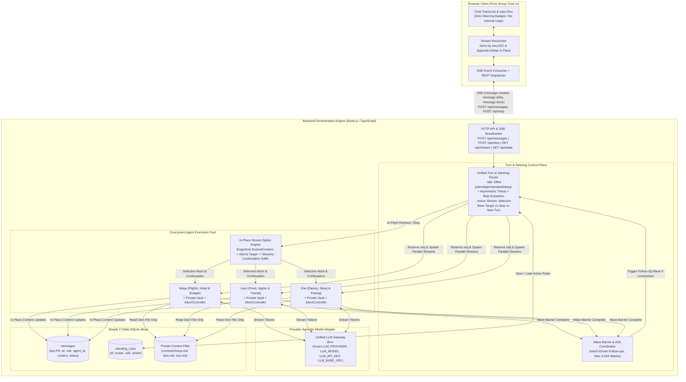
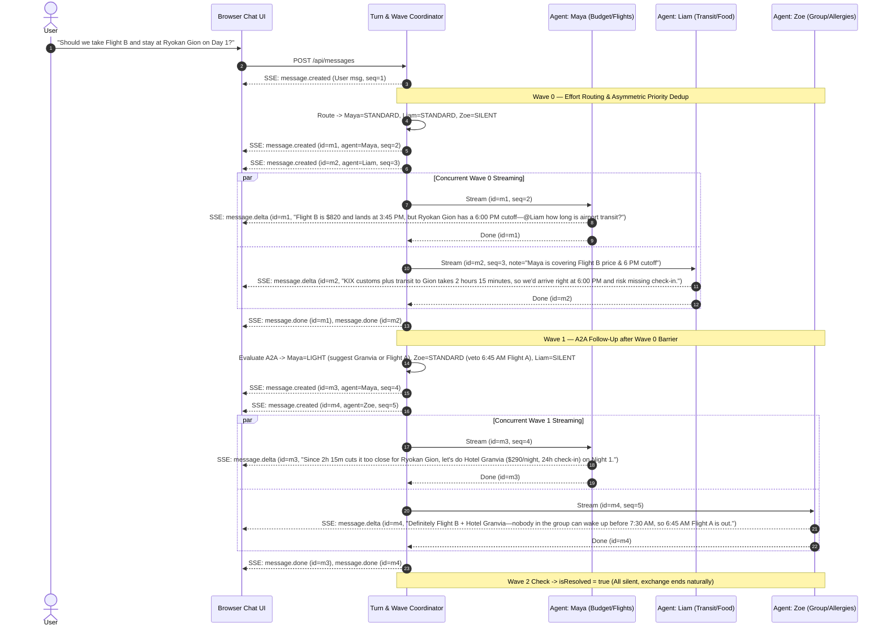
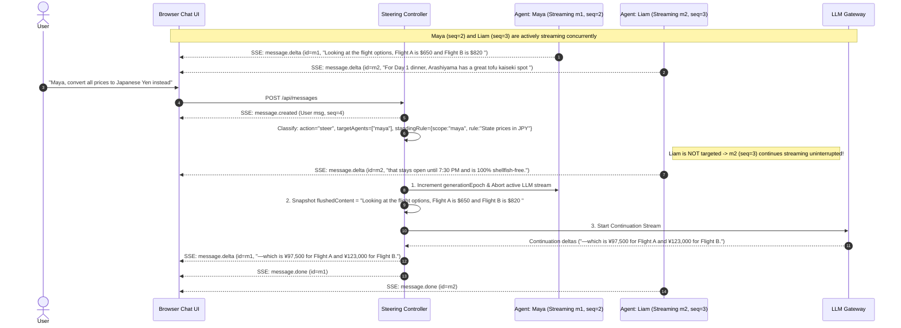

# Multi-Turn Agent Steering — System Architecture

## 1. Architectural Overview

The **Multi-Turn Agent Steering** system is a real-time, multi-agent group chat application where three distinct agents (**Maya**, **Liam**, **Zoe**) with isolated private context files participate concurrently in a shared conversation. Users can steer any or all agents while they are actively streaming—seamlessly altering the trajectory of an in-flight response within the same message bubble, persisting standing rules across reloads, or halting generation—all without exposing internal orchestration mechanics in the UI.

### Core Design Principles (Every Component Maps to a Requirement)
1. **Strict Context Isolation**: Each agent owns a private markdown file (`maya.md`, `liam.md`, `zoe.md`) that is never injected into another agent's prompt. Cross-domain synthesis happens organically through the shared conversation transcript and agent-to-agent follow-ups.
2. **Pre-Response Effort & Asymmetric Dedup Router (Stretch)**: Before opening a visible message bubble, a single fast JSON router assigns each agent an effort tier (`silent`, `light`, `standard`, or `deep`) and a 1-line `thesis`. Using asymmetric speaker priority (`Agent 1 -> Agent 2 -> Agent 3`), later speakers are told what earlier speakers are covering so overlapping points are stated once and never dropped by both.
3. **Seamless In-Flight Steering (Same-Bubble Continuation)**: When a user sends a message while streams are active, the **Steering Classifier** identifies whether to `stop_all`, `steer` specific `targetAgents` (leaving non-targeted agents streaming untouched), or start a new turn. Targeted streams abort their upstream LLM request, snapshot `flushedContent`, increment `generationEpoch` (blocking late zombie tokens), and immediately open a continuation stream into the **exact same `messageId` and `seq`**.
4. **Deterministic Ordering via Single Integer `seq`**: Every message row in SQLite receives a strictly increasing `seq INTEGER PRIMARY KEY AUTOINCREMENT` reserved **before** streaming starts. Both live SSE streams and full page reloads sort by `seq ASC`.
5. **Single-Config Provider-Agnostic LLM Layer**: All model calls route through one `LLMProvider` adapter configured via `.env` (`LLM_PROVIDER`, `LLM_MODEL`, `LLM_API_KEY`, optional `LLM_BASE_URL`).

---

## 2. High-Level System Architecture Diagram



---

## 3. Core Subsystems & Requirement Mapping

### 3.1 The Group: Distinct Personalities & Private Context Isolation

| Agent Name | Role & Personality | Private Context Vault (`src/server/contexts/<agent>.md`) |
| :--- | :--- | :--- |
| **Maya** | **Budget, Flights & Lodging** — Direct, numbers-first, cost-conscious, focused on concrete prices and booking cutoffs. | $4,800 total group budget ($1,200/person); Flight A (ANA 6:45 AM, $650, lands 11:00 AM) vs. Flight B (JAL 11:30 AM, $820, lands 3:45 PM); Ryokan Gion ($380/night, strict 6:00 PM check-in cutoff for kaiseki dinner) vs. Hotel Granvia ($290/night, 24h check-in at Kyoto Station). |
| **Liam** | **Local Guide (Food, Sights & Transit)** — Warm, food-obsessed, energetic storyteller focused on transit timing and authentic spots. | KIX airport to Gion takes 2h 15m after customs; Nishiki Market Street Food Tour (11 AM–2 PM, heavy shared-grill shellfish/seafood); Arashiyama Tofu Kaiseki (vegetarian & shellfish-safe, last seating 7:30 PM); sight crowd windows. |
| **Zoe** | **Group Dynamics, Health & Pacing** — Empathetic, observant, protective of the group's sanity, allergies, and sleep schedule. | Sam has a severe shellfish allergy (cannot eat near shared seafood grills) and boat/bus motion sickness; Priya is strict vegetarian; group rule against waking before 7:30 AM (ruling out 6:45 AM flights). |

### 3.2 Pre-Response Effort Router & Asymmetric Anti-Repetition Gate (Stretch)
Before generating a visible response in any wave, the router outputs for each agent:
- `effort`: `'silent' | 'light' | 'standard' | 'deep'`
- `thesis`: 1-line summary of the unique point the agent will make.
- **Asymmetric Priority**: Speaking agents are ordered `[Agent 1, Agent 2, Agent 3]`. Agent 1 covers its full `thesis`. Agent 2 receives a 1-line note of what Agent 1 is covering (`"Agent 1 is already covering <thesis>; add only your distinct angle"`). Agent 3 sees what Agents 1 & 2 are covering.
- **Effort Calibration (Single Model, Token & Prompt Calibration)**:
  - `silent`: No message row created.
  - `light`: 1 concise sentence (`max_tokens: 80`).
  - `standard`: 2–4 sentences (`max_tokens: 250`).
  - `deep`: Detailed synthesis (`max_tokens: 600`).

### 3.3 Concurrent Streaming & Bounded Agent-to-Agent (A2A) Waves
- **Wave 0**: All speaking agents reserve their `seq` in SQLite up front and stream tokens concurrently over SSE.
- **Wave Barrier**: No follow-up wave evaluates until all active streams in the current wave finish (or are stopped).
- **Wave 1..3 (Intent-Driven Follow-Up)**:
  - Evaluates whether an agent asked a peer a question or revealed a constraint that requires another agent's private facts (`nextSpeakers`, `isResolved`).
  - Stops immediately as soon as `isResolved === true` or `nextSpeakers` is empty.
  - Capped at a maximum of 3 follow-up waves, where the final wave instructs a concise wrap-up with no further questions.

### 3.4 Selective Mid-Stream Steering & In-Place Stream Splicing
When a user submits a message while one or more agents are actively streaming:
1. **Steering Classification**: One fast JSON call returns:
   - `action`: `'steer' | 'stop_all' | 'new_turn'`
   - `targetAgents`: e.g. `['maya']` (if named/targeted) or all currently streaming agents (if global).
   - `standingRule`: optional `{ scope: 'global' | 'maya' | 'liam' | 'zoe', rule: string }`.
2. **Selective Abort (Others Continue)**: Only agents in `targetAgents` have their `AbortController` aborted and `generationEpoch` incremented. Non-targeted streaming agents continue uninterrupted.
3. **In-Place Continuation into Same `messageId` & `seq`**:
   - Captures `flushedContent` (exact text already sent to client for that bubble).
   - Starts a continuation stream for the **same `messageId` and `seq`** with `<already_spoken>${flushedContent}</already_spoken>` and the user's redirect instruction, streaming only the new suffix tokens.
   - A lightweight seam check strips any accidental word overlap with the end of `flushedContent`.

---

## 4. Sequence Diagrams

### 4.1 Concurrent Multi-Agent Streaming + Agent-to-Agent Follow-Up



### 4.2 Mid-Stream In-Place Steering Redirect (Per-Agent & Seamless Continuation)



### 4.3 Standing Instruction Persistence Across Reloads

```mermaid
sequenceDiagram
    autonumber
    actor User
    participant UI as Browser Chat UI
    participant Orch as Orchestrator
    participant DB as SQLite Store

    User->>UI: "Always answer in bullet points."
    UI->>Orch: POST /api/messages
    Orch->>DB: INSERT INTO standing_rules (scope='global', rule='Answer in bullet points')
    Note over Orch,UI: Active streams (if any) splice in-place to bullet points; future turns load rule from DB

    User->>UI: Browser Reload (F5)
    UI->>Orch: GET /api/state
    Orch->>DB: SELECT * FROM messages ORDER BY seq ASC
    DB-->>Orch: Ordered messages
    Orch-->>UI: { messages } (Exact same seq order; zero internal metadata exposed)
```

---

## 5. Data Model & Configuration

### 5.1 Two-Table SQLite Schema

```sql
CREATE TABLE messages (
    seq INTEGER PRIMARY KEY AUTOINCREMENT, -- Canonical sort order (1, 2, 3...)
    id TEXT UNIQUE NOT NULL,
    role TEXT NOT NULL,                    -- 'user' | 'agent'
    agent_id TEXT,                         -- NULL for user; 'maya' | 'liam' | 'zoe' for agents
    content TEXT NOT NULL DEFAULT '',      -- Updated in-place as deltas stream
    status TEXT NOT NULL,                  -- 'streaming' | 'completed'
    created_at INTEGER NOT NULL
);

CREATE TABLE standing_rules (
    id TEXT PRIMARY KEY,
    scope TEXT NOT NULL,                   -- 'global' | 'maya' | 'liam' | 'zoe'
    rule TEXT NOT NULL,
    active INTEGER NOT NULL DEFAULT 1,
    created_at INTEGER NOT NULL
);
```

### 5.2 Environment Configuration (`.env`)

```bash
LLM_PROVIDER="openai"                      # "openai" | "anthropic" | "gemini" | "openai-compatible"
LLM_MODEL="gpt-4o-mini"                    # Any model slug
LLM_API_KEY=""                             # Filled in by user
LLM_BASE_URL=""                            # Optional custom endpoint
```
