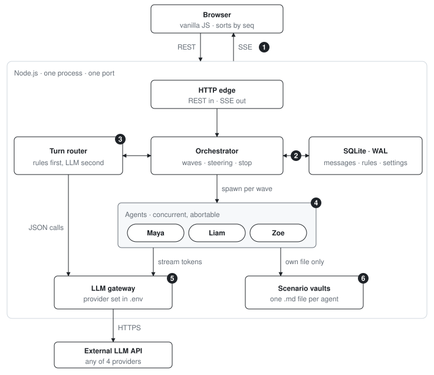
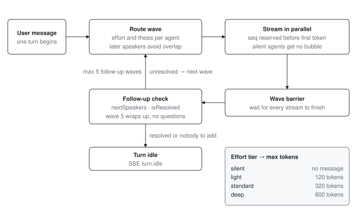
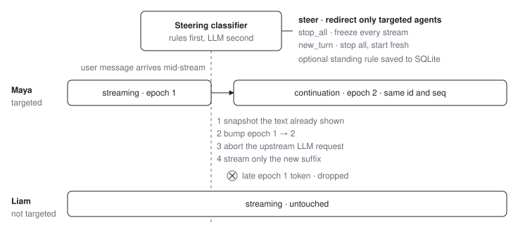

# Emanate Case Study

A three-agent group chat. Maya, Liam, and Zoe each have a private knowledge vault. They stream concurrently, follow up with each other when a question needs another agent's facts, and you can redirect any of them **while they are still typing**, in the same message bubble.

Internal machinery (effort, theses, epochs, standing rules) never reaches the browser.

## How it is built

One Node.js process, one port, no queue, no extra containers. The browser is vanilla JS. Persistence is SQLite. Model choice is an `.env` change.



Numbered decisions, matching the diagram:

1. **REST in, SSE out.** The wire carries only public chat fields (`seq`, `id`, `role`, `content`, `status`). Orchestration internals cannot leak into the UI.
2. **`seq` is reserved in SQLite before any token streams.** Live view and page reload both sort by that one integer, so concurrent streams never reorder.
3. **Cheap deterministic rules run first** (explicit `stop`, `@mentions`, obvious standing rules). The LLM is only asked when the case is actually ambiguous.
4. **Each agent stream has its own abort controller and an epoch.** Steering one agent does not touch the others. See [Steering](#steering) below.
5. **One `LLMProvider` interface.** Switching OpenAI / Anthropic / Gemini / OpenAI-compatible is a `.env` change. Tests use a scripted mock and run offline.
6. **An agent loads only its own markdown file.** Isolation is structural. A new scenario is a folder, not a code change.

## How a turn works

A user message starts a turn. The router assigns each agent an effort tier and a one-line thesis. Later speakers are told what earlier speakers will cover, so overlapping points are stated once. Agents that are `silent` never get a bubble.

Speaking agents reserve a `seq`, then stream in parallel. A **wave barrier** waits for every stream to finish. Then a follow-up check asks: did anyone raise a question that needs another agent's private facts? If so, another wave starts, up to five. Wave 5 wraps up with no further questions.



| Effort | What it does | Max tokens |
| --- | --- | ---: |
| silent | No message created | — |
| light | One short sentence | 120 |
| standard | A few sentences | 320 |
| deep | Detailed synthesis | 800 |

## Steering

If you send a message while agents are still streaming, it is classified as one of:

- **`steer`** — redirect only the named (or implied) agents, in the same bubble.
- **`stop_all`** — freeze every stream immediately.
- **`new_turn`** — stop everyone, then start a fresh turn.

A standing rule (`Always answer in bullet points`, `Maya, quote prices in JPY`) is saved to SQLite and survives reload.

On `steer`, only the targeted agent is interrupted:

1. Snapshot the text already on screen.
2. Bump that stream's epoch (`1 → 2`).
3. Abort the upstream LLM request.
4. Stream only the new suffix into the **same** `id` and `seq`.

A late token from the aborted request still has epoch 1, so it is dropped. Untargeted agents keep streaming.



## Quickstart

Node.js `v20+`.

```bash
npm install
cp .env.example .env   # set LLM_API_KEY
npm start              # http://localhost:3000
```

```bash
npm run typecheck
npm test
```

## Swap the model

All LLM calls go through `src/server/llm.ts`, configured only by `.env`:

```bash
LLM_PROVIDER="openai"          # openai | anthropic | gemini | openai-compatible
LLM_MODEL="gpt-4o-mini"
LLM_API_KEY="sk-..."
LLM_BASE_URL=""                # optional: OpenRouter, vLLM, Ollama
STREAM_PACE_MS="25"            # optional token pacing for mid-stream steering
```

Built and verified against OpenAI `gpt-4o-mini`. For Anthropic, Gemini, or a local / OpenRouter endpoint, change the three provider fields; no code change.

## The group

The same three slots (Maya, Liam, Zoe) run any **scenario**. Pick one from the header dropdown; switching starts a new chat. Two ship today: **Kyoto & Osaka Trip** (`kyoto-trip`, default) and **Project Nova EU Launch** (`nova-launch`).

A new scenario is a folder `src/server/scenarios/<id>/` with `maya.md`, `liam.md`, `zoe.md`, and a `scenario.json` manifest. Listed at `GET /api/scenarios`; activated with `POST /api/scenario`.

Default scenario, a 5-day Kyoto & Osaka trip for four friends:

| Agent | Role | Exclusive private vault |
| :--- | :--- | :--- |
| **Maya** | Budget, flights & lodging | $4,800 group budget; Flight A vs B; Ryokan Gion (6:00 PM cutoff) vs Hotel Granvia |
| **Liam** | Food, sights & transit | KIX → Gion is 2h 15m; Nishiki shared-grill seafood tour; Arashiyama tofu kaiseki |
| **Zoe** | Group health & pacing | Sam's shellfish allergy; Priya is vegetarian; no waking before 7:30 AM |

## Try these

1. **Cross-vault synthesis + follow-up waves.** *Should we take Flight B and stay at Ryokan Gion on Day 1?* Maya quotes the 6:00 PM cutoff; Liam reveals 2h 15m transit (zero buffer); the next wave has Maya suggest Hotel Granvia and Zoe veto the 6:45 AM Flight A.

2. **Steer one agent mid-stream.** Ask *@Maya and @Liam* for a flight and hotel breakdown, then while both are streaming: *Maya, convert all prices to Japanese Yen instead.* Liam continues. Maya pivots to yen **in the same bubble**.

3. **Steer everyone.** While streams are active: *Actually, wrap up in one short uppercase sentence.*

4. **Standing rule across reload.** *Always answer in concise bullet points from now on.* Refresh. New questions still come back as bullets, in the original `seq` order.

5. **Silence gate.** *@Maya what is the total group budget?* Liam and Zoe stay silent. Maya answers in one sentence (`light`).

6. **Stop.** Click **Stop** (or type `stop`) while agents are streaming. Everything freezes at the flushed text.

See [`ARCHITECTURE.md`](./ARCHITECTURE.md) for sequence diagrams and the full data model.
